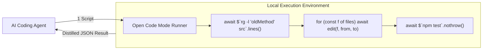

# Open Code Mode (OCM)

> Universal programmatic tool execution engine for AI coding agents.

Inspired by Claude Code's **Code Mode**, **Open Code Mode** enables any AI agent (Claude, OpenAI, Gemini, DeepSeek, Cursor, Cline, Windsurf, Antigravity) to write and execute JavaScript/TypeScript scripts that compose shell commands, file edits, searches, and tests in a single programmatic step.

---

## Why Code Mode?

### Traditional Tool Calling (ReAct Loop)
1. Agent calls `grep` -> wait for 1,000 lines of output into context window.
2. Agent reads file 1 -> wait for content in context.
3. Agent edits file 1 -> wait for confirmation.
4. Agent runs tests -> wait for failure logs.
5. High latency, context window pollution, and high token costs.

### Open Code Mode
1. The agent writes an executable async script.
2. Loops, file filtering, string parsing, and command pipelines run locally in milliseconds.
3. Only the distilled outcome or specific error is returned to the agent.
4. **Result**: Up to 90% fewer tokens, 10x-50x faster execution, and atomic multi-file refactoring in a single agent turn.



---

## Key Features

- **Async Shell Helper (`` $`...` ``)**: Template-tag shell execution with automatic argument escaping, `.text()`, `.lines()`, `.json()`, `.nothrow()`, and `.cwd(dir)`.
- **Surgical Filesystem Operations**: Atomic `read()`, `write()` (with auto-directory creation), `edit()` (exact surgical replacement), `patch()` (functional transformer), `exists()`, `glob()`, and `list()`.
- **Model Context Protocol (MCP) Server**: Zero-dependency stdio JSON-RPC 2.0 server ready to drop into Cursor, Windsurf, Claude Code, Cline, Goose, or Zed.
- **Universal Agent Adapters**: Direct tool definitions for OpenAI, Anthropic Claude, Google Gemini, and Vercel AI SDK.
- **Lightweight & Dependency-Free**: Built entirely with Node.js standard library (`node:child_process`, `node:fs/promises`, `node:readline`, `node:test`).

---

## Quick Start

### 1. Run with CLI

```bash
# Execute an inline Code Mode script
npx code-mode run "return await $\`git status -s\`.lines()"

# Execute a script file
npx code-mode run ./scripts/refactor.js

# Launch interactive Code Mode REPL
npx code-mode repl
```

### 2. Connect as an MCP Server

Add to your MCP configuration (`claude_desktop_config.json`, `cline_mcp_settings.json`, or `.cursor/mcp.json`):

```json
{
  "mcpServers": {
    "code-mode": {
      "command": "node",
      "args": ["/path/to/code-mode/bin/code-mode.js", "mcp"]
    }
  }
}
```

Once connected, your agent receives the `code_mode` tool and can execute multi-step workflows in a single turn.

### 3. Use in Agent Code (Vercel AI SDK / LangChain / Raw API)

```javascript
import { generateText } from 'ai';
import { openai } from '@ai-sdk/openai';
import { toVercelAITool, CODE_MODE_SYSTEM_PROMPT } from 'code-mode';

const result = await generateText({
  model: openai('gpt-4o'),
  system: CODE_MODE_SYSTEM_PROMPT,
  tools: {
    code_mode: toVercelAITool()
  },
  prompt: 'Find all occurrences of "v1/users" in src/ and update them to "v2/users", then run the test suite.'
});
```

---

## Script Environment API Reference

Inside every Code Mode script, the following globals are available:

### Shell Execution (`$`)
```javascript
// Run a command and get trimmed stdout
const branch = await $`git branch --show-current`.text();

// Split output lines into an array
const files = await $`rg -l "deprecatedFunc" src`.lines();

// Parse JSON output directly
const pkg = await $`cat package.json`.json();

// Suppress throwing on non-zero exit code
const testRun = await $`npm test`.nothrow();
if (testRun.exitCode !== 0) {
  console.log("Tests failed:", testRun.stderr);
}

// Change working directory
const subOut = await $.cwd('./packages/core')`pwd`.text();
```

### Filesystem (`read`, `write`, `edit`, `patch`, `exists`, `glob`)
```javascript
// Read file content
const config = await read('tsconfig.json');

// Write file (automatically creates parent directories)
await write('dist/output.txt', 'generated payload');

// Surgical text replacement (throws if target is missing or ambiguous)
await edit('src/config.ts', 'port: 3000', 'port: 8080');

// Functional patch
await patch('src/version.ts', (content) => content.replace(/\d+\.\d+\.\d+/, '1.0.1'));

// Check existence
if (await exists('.env')) { ... }

// Find files via glob pattern
const tsFiles = await glob('src/**/*.ts');
```

---

## Running Tests

Open Code Mode uses Node.js's built-in test runner:

```bash
npm test
```

---

## License

MIT
